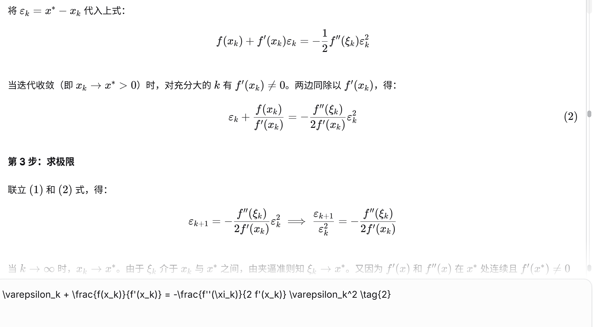

# Copy Math Formulas as LaTeX in Google AI Studio

[简体中文](./README.md) | **English**

Copying rendered math formulas from Google AI Studio can produce fragmented text instead of usable LaTeX. For example, copying `\varepsilon_k + \frac{f(x_k)}{f'(x_k)}` may give you:

```text
ε
k
​
 +
f
′
 (x
k
​
 )
f(x
k
​
 )
​
```

This output is difficult to organize and reuse. This Tampermonkey userscript solves that problem by letting you copy formulas as LaTeX source and is currently the most polished version available.

It also fixes some multiline equation rendering errors in Google AI Studio.



Select a response containing formulas in [Google AI Studio](https://aistudio.google.com/), then press `Ctrl+C` or `⌘C` to copy both the text and formulas as plain text. The script reads the original LaTeX from the page's KaTeX markup, preserving subscripts, superscripts, and fraction commands.

For example, selecting a sentence with an inline formula gives you:

```text
Function value basis function (corresponding to f(x_k))
```

Instead of fragmented output such as:

```text
Function value basis function (corresponding to f
(
x

k
)

f
(
x

k
)
)
```

When you select only ordinary text, copying works as usual.

## Installation

1. Install [Tampermonkey](https://www.tampermonkey.net/) in your browser.
2. Open [aistudio-copy-latex.user.js](./aistudio-copy-latex.user.js), click **Raw** on the GitHub file page, and copy the entire script.
3. Click the Tampermonkey icon and choose **Create a new script**. Replace the default contents with the copied script and save it.
4. Refresh [Google AI Studio](https://aistudio.google.com/).

If the script does not run in Chrome, open Tampermonkey's extension details, make sure **Allow User Scripts** is enabled, and refresh the page. See the [Tampermonkey FAQ](https://www.tampermonkey.net/faq.php?q=Q209).

## Usage

- **Copy a formula or paragraph:** Select a formula or text containing formulas, then press `Ctrl+C` or `⌘C`.
- **Copy through the Tampermonkey menu:** Select the text, then click **复制选区中的 LaTeX** (Copy LaTeX from selection). The script's menu labels are currently in Chinese.

## Fixing Multiline Equations

Before AI Studio renders formulas, the script repairs missing row separators in environments such as `aligned` and `cases`. For example, it converts a single backslash at the end of a line into `\\`, and converts a spacing command such as `\[8pt]` into `\\[8pt]`.

The script attempts these repairs before AI Studio parses the response's Markdown, including when formulas appear directly next to text or punctuation. Examples inside fenced code blocks are left unchanged. Multiline formulas with math delimiters that still appear as source text can also be rendered by the script.

If AI Studio displays an entire formula block as ordinary text, the script also attempts to recognize and render it in place. It only repairs row separators; other characters in the formula are preserved. For formulas originally displayed as ordinary text, it retains the formula source from before Markdown parsing and renders the formula at the corresponding location in the response.

Rendering happens locally in your browser using a pinned version of KaTeX. By default, formulas use KaTeX's HTML styling while retaining MathML and the original LaTeX. If the styles are unavailable, rendering falls back to the browser's MathML support.

You can also select a complete formula from `\begin{...}` to `\end{...}`, then click **预览修复后的多行 LaTeX** (Preview repaired multiline LaTeX) in the Tampermonkey menu. The preview lets you copy the repaired source.

## Scope and Limitations

The script runs only on `aistudio.google.com`. Formulas must have readable LaTeX source available in the page; formulas in images cannot be converted. Copying is handled locally in your browser.

If you find this script useful, consider giving the repository a star ⭐. Your support helps keep the project going. Thank you!
