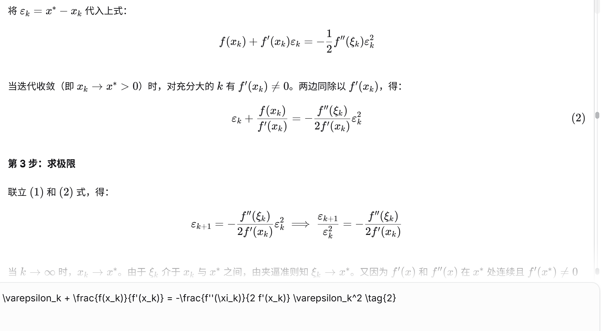

# 在 AI Studio 选中数学公式复制得到 LaTeX 

**简体中文** | [English](./README.en.md)

AI Studio的公式复制是不可用的，比如你想复制公式 `\varepsilon_k + \frac{f(x_k)}{f'(x_k)} `的时候
会得到：
```text
ε 
k
​
 + 
f 
′
 (x 
k
​
 )
f(x 
k
​
 )
​
```
这是难以整理和引用的，这个插件可以解决这个问题，它是当前最完美的可用版本。  
此外，这个插件还解决了aistudio多行公式生成渲染错误的问题。  


你只要在 Google AI Studio 里选中带公式的回复，按 `Ctrl+C` 或 `⌘C`，即可把正文和公式一起复制为纯文本。脚本从网页的 KaTeX 标记中读取原始 LaTeX，保留下标、上标和分式命令，方便整理笔记。

例如，选中包含行内公式的一整句，可以得到下面的文本:

```text
函数值基函数（对应 f(x_k) ）
```
而不是
```text
函数值基函数（对应 f
(
x

k
)

f
(
x

k
) 
）
```

只选中普通文字时，浏览器照常复制。

## 安装

1. 在浏览器中安装 [Tampermonkey（篡改猴）](https://www.tampermonkey.net/)。
2. 打开 [aistudio-copy-latex.user.js](./aistudio-copy-latex.user.js)，点 GitHub 文件页的 **Raw**，复制完整脚本。
3. 点击篡改猴图标，选择**添加新脚本**。用复制的代码替换默认内容并保存。
4. 刷新 [Google AI Studio](https://aistudio.google.com/)。

如果脚本没有运行，在 Chrome 中打开篡改猴的扩展详情，确认已开启 **允许用户脚本**，然后刷新网页。 [篡改猴官方说明](https://www.tampermonkey.net/faq.php?q=Q209)

## 使用

- **复制公式或段落**。选中公式或包含公式的正文，按 `Ctrl+C` 或 `⌘C`。
- **通过篡改猴菜单复制**。先选中文本，再点击 **复制选区中的 LaTeX**。

## 修复多行公式

脚本会在 AI Studio 渲染公式前，修正 `aligned`、`cases` 等环境中缺失的行分隔符。例如，行末的单个反斜杠会补成 `\\`，用于行距的 `\[8pt]` 会补成 `\\[8pt]`。

即使公式紧挨正文或标点，脚本也会尝试在 AI Studio 解析回复的 Markdown 之前补齐行分隔符。代码围栏里的示例保留原样。对带有数学标记但仍显示源码的多行公式，脚本也会直接排版。

如果 AI Studio 把一整块公式显示成普通文本，脚本也会尝试识别并在原位置排版。它只修正行分隔符，公式中其他字符按原样保留。对原本作为普通文本显示的公式，脚本会保留解析前的公式原文，并在回复对应位置直接排版。脚本用固定版本的 KaTeX 在浏览器本地排版。默认使用 KaTeX 的 HTML 样式显示公式，同时保留 MathML 和原始 LaTeX。样式资源不可用时，退回浏览器的 MathML 排版。

也可以完整选中从 `\begin{...}` 到 `\end{...}` 的公式，然后在篡改猴菜单点击 **预览修复后的多行 LaTeX**。预览里可复制修正后的源码。

## 适用范围

脚本只在 `aistudio.google.com` 上运行。公式需要在网页中保留可读取的 LaTeX 源码，图片里的公式无法转换。复制操作在浏览器本地完成。


如果觉得这个插件好用，可以给个star⭐支持一下oo，你的star也是我持续更新的动力，谢谢😊。